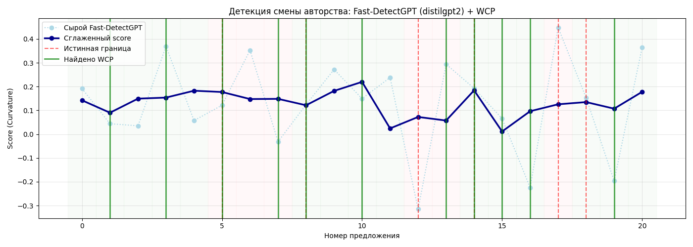
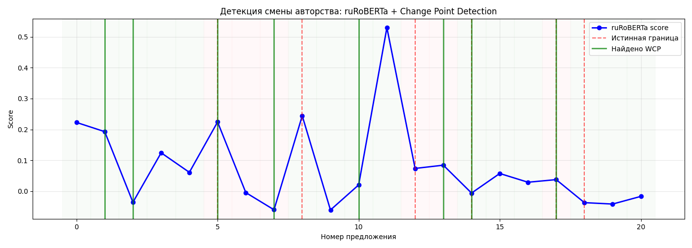

В ходе тестирования на локальном железе (RTX 4050 6GB) были проверены разные архитектуры нейросетей. Для наглядности использовался синтетический текст из 21 предложения с заранее известными границами смены автора(Изначальные тесты проводились на собранном датасете, примеры приближенны по результатам).

1. Fast-DetectGPT (на базе distilgpt2)

*   Как работает: Считает статистику кривизны через сэмплирование токенов.
*   Проблема: Как видно на графике, сырые скоры (бледная линия) обладают огромной дисперсией. Слабая модель `distilgpt2` не может стабильно предсказывать вероятности, из-за чего возникают хаотичные скачки.
*   Результат: Даже после сглаживания (жирная линия) сигнал остается зашумленным. Алгоритм WCP (зеленые линии) генерирует множество ложных срабатываний, реагируя на шум, а не на реальный стиль текста.

2. Энкодеры на базе RoBERTa

*   Как работает: Используется как энкодер, скор берётся с выхода классификационной головы.
*   Решение: В отличие от генеративных моделей, энкодеры показывают гораздо более стабильный и гладкий сигнал. Они лучше улавливают стилистические паттерны на уровне слов и контекста.
*   Результат:** Алгоритм WCP четко выделяет локальные пики и падения скора. На графике видно, что найдено несколько точных границ (например, на индексах 5, 14, 17), совпадающих с истинными. Количество ложных срабатываний значительно ниже.
*   Важное замечание: Базовая английская модель `roberta-base` и русскоязычная `ruRoBERTa` в ходе тестов показали **примерно одинаковый уровень результатов**. Обе архитектуры стабильно справляются с задачей локализации границ.

Также энкодеры на базе RoBERTa изначально созданы под дообучение, что вкупе с хорошими базовыми результатами делает её предпочтительной для дальнейшей работы.
